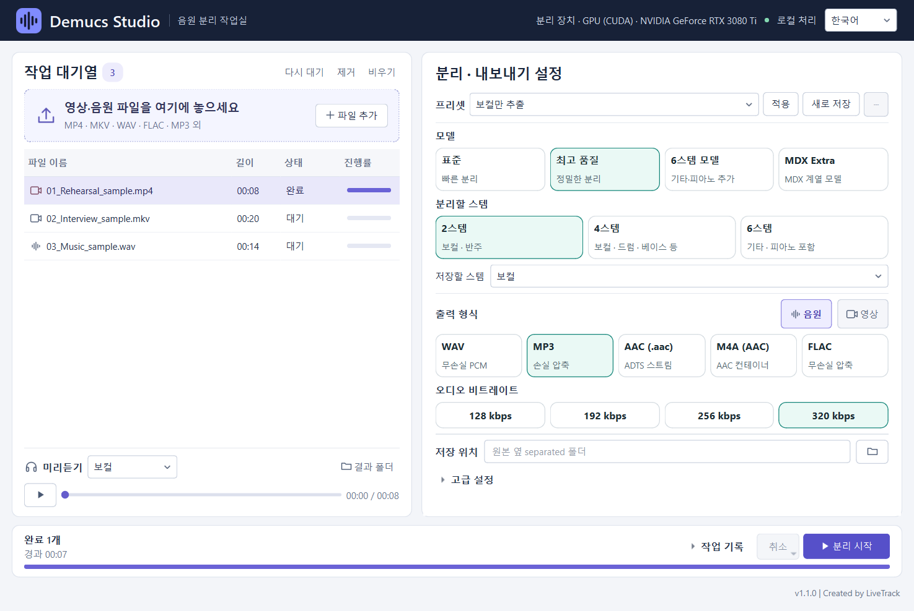
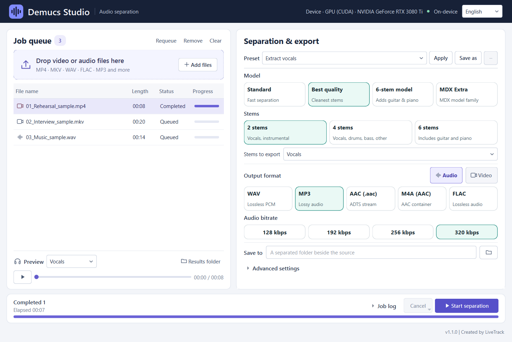

# Demucs Studio

[한국어](#한국어) · [English](#english)

Windows에서 영상·음원의 보컬과 악기를 분리해 영상 또는 음원으로 저장합니다. 한국어와 영어를 지원합니다.

Separate vocals and instruments from video or audio on Windows. Save the stems as audio files or put a selected stem back into the original video. The interface is available in English and Korean.



## 한국어

### 설치와 첫 작업

1. Windows x64용 설치 파일을 실행하고 시작 메뉴에서 **Demucs Studio**를 엽니다. 앱 상단에서 **한국어** 또는 **English**를 고르면 다음 실행에도 적용됩니다. [Windows 설치 파일](https://github.com/LiveTrack-X/Demucs-Studio/releases/latest/download/DemucsStudio-Setup-x64.exe) · [최신 릴리즈](https://github.com/LiveTrack-X/Demucs-Studio/releases/latest)
2. 원본 파일을 창에 끌어놓거나 **파일 추가**를 누릅니다. 여러 개를 넣으면 순서대로 처리합니다.
3. 모델과 스템 수를 고른 뒤 **저장할 스템**을 지정합니다. **영상** 또는 **음원**을 선택하고 형식과 음질을 고릅니다.
4. **분리 시작**을 누릅니다. 작업 중에도 파일을 추가할 수 있고, 설정 변경은 다음 파일부터 적용됩니다.
5. 완료한 항목을 선택하면 미리듣기에 **보컬**이 열립니다. 보컬을 저장하지 않았다면 첫 번째 저장 스템이 열립니다. 같은 위치의 소리를 비교하려면 미리듣기 목록에서 **원본**을 고릅니다. **결과 폴더**에서 저장한 파일을 열 수 있습니다.

| 원하는 결과 | 설정 예시 |
|---|---|
| 원본 화면에 보컬을 남긴 영상 | 영상 → MP4 → 보컬 |
| 보컬을 제거한 영상 | 영상 → MP4 또는 MKV → 반주 |
| 보컬만 담은 음원 | **보컬만 추출** 프리셋 → 적용 → 분리 시작. 24-bit WAV 보컬 한 개를 저장합니다. |
| 작은 용량의 반주 음원 | 음원 → MP3 → 192 kbps → 반주 |
| 악기별 파일 | **악기별 분리** 프리셋. 4개 스템을 각각 저장합니다. 6스템에서는 기타와 피아노도 따로 고를 수 있습니다. |

**보컬**은 음악에서 사람의 목소리를 추출합니다. 방송이나 영상에서는 진행자의 말소리와 배경곡 가수의 노랫소리가 한 파일에 함께 남을 수 있습니다.

**표준**, **최고 품질**, **6스템 모델**은 Demucs v4의 구간 길이와 겹침 방식으로 분리합니다. 고급 설정에서 **Shifts**가 1 이상이면 모델이 입력을 무작위로 조금 이동하므로 같은 설정으로 다시 실행해도 짧은 구간의 잔여음이 달라질 수 있습니다. 동일 입력을 반복 비교할 때는 **Shifts 0**으로 이 이동을 끌 수 있습니다.

기본 저장 위치는 원본 옆의 `separated\원본명\`입니다. 예를 들어 `공연.mp4`의 보컬 영상은 `공연_vocals.mp4`로 저장됩니다. 같은 이름의 결과가 있으면 새 번호 폴더를 만듭니다. 기존 파일을 다른 형식으로 다시 뽑으려면 대기열에서 해당 항목을 선택하고 **다시 대기**를 누릅니다.

### 분리 강도와 잔여음

기본값은 **최고 품질 · 분리 강도 100% · 잔여음 억제 6 dB**입니다. 처음에는 파일을 추가하고 원하는 스템과 출력 형식만 고르면 됩니다.

| 고급 설정 | 출력에 미치는 영향 |
|---|---|
| **분리 강도** (0~100%) | 100%는 선택한 스템만 저장합니다. 50%는 원본과 분리한 스템을 같은 비율로 섞습니다. 0%는 원본 믹스를 선택한 출력 형식으로 저장합니다. |
| **잔여음 억제** (0~24 dB) | 다른 소리가 우세한 시간·주파수에서 스템에 남은 소리를 설정한 값까지 줄입니다. 크게 설정하면 약한 목소리나 악기의 여운도 줄어들 수 있습니다. 0 dB는 추가 억제를 끕니다. |

예를 들어 보컬 뒤에 반주를 조금 남기려면 **보컬 · 분리 강도 75%**를 사용합니다. Demucs가 계산한 스템을 그대로 내보내려면 **100% · 0 dB**를 사용합니다. 같은 조절이 음원과 영상 출력에 모두 적용됩니다.

### 내 프리셋과 업데이트

분리 강도, 잔여음 억제, 모델, 스템, 포맷, 음질, 장치, Shifts, Overlap, 저장 위치를 조정하고 **새로 저장**에서 이름을 입력합니다. 다음 실행에서도 **프리셋** 목록에서 선택해 **적용**할 수 있습니다. **⋯** 메뉴로 이름을 바꾸거나 삭제합니다.

하단의 **버전 | Created by LiveTrack**을 누르면 이 저장소가 열립니다. 새 정식 버전이 있으면 주황색 **Update**가 표시됩니다. 분리 작업이 끝난 뒤 버튼을 누르면 릴리즈 설치 파일을 내려받아 SHA-256을 검증하고 업데이트를 적용합니다. 버전 표시를 오른쪽 클릭하면 직접 확인할 수 있습니다.

### 출력 형식과 타임라인

| 형식 | 선택 가능한 음질 |
|---|---|
| WAV | 16-bit PCM, 24-bit PCM, 32-bit float |
| FLAC | 16-bit, 24-bit 무손실 |
| MP3, AAC (.aac), M4A (AAC) | 128, 192, 256, 320 kbps |
| MP4, MKV | 영상에 넣을 AAC 음질 128, 192, 256, 320 kbps |

영상 출력은 원본 화면과 분리한 소리 한 트랙을 결합합니다. 전체 스템을 선택하면 스템마다 영상 한 개가 생깁니다. 선택한 컨테이너가 원래 영상 코덱을 지원하면 영상 스트림을 그대로 복사하고, 호환되지 않으면 H.264로 변환합니다. 여러 오디오 트랙이 있는 영상에서는 기본 트랙을 사용합니다.

분리는 스테레오 44.1 kHz로 계산합니다. WAV·FLAC는 원본 오디오의 샘플레이트로 저장하며 원래의 샘플 수를 기준으로 재구성합니다. 영상은 화면과 오디오의 상대적 시작 시간을 유지합니다. 음원 파일은 선택한 오디오 트랙의 첫 샘플에서 시작합니다. AAC를 고르면 ADTS 파일(.aac)이, M4A를 고르면 AAC를 담은 .m4a 파일이 만들어집니다. MP3·AAC의 표시 길이는 재생기의 인코더 지연 처리에 따라 달라질 수 있습니다.

### 장치와 긴 파일

상단의 **분리 장치**에서 CPU 또는 GPU의 실제 이름을 확인할 수 있습니다. **고급 설정**에서 장치를 바꾸면 표시도 바로 바뀝니다. 자동은 사용 가능한 CUDA GPU를 우선합니다. 사용한 장치와 모델 다운로드 진행 상황은 작업 기록에도 표시됩니다. 미디어는 이 PC에서 처리하고, 모델 가중치는 처음 필요할 때 Demucs 공식 서버에서 내려받아 사용자 계정의 PyTorch 캐시에 보관합니다. 같은 모델과 스템은 이후 오프라인으로 사용할 수 있습니다.

긴 파일은 짧은 구간으로 나눠 처리합니다. 임시 파일은 저장 위치의 디스크를 사용합니다. 5시간짜리 스테레오 44.1 kHz의 경우 디코딩한 원본과 분리 중인 스템 각각에 약 6.35 GB가 필요합니다. 전체 스템을 영상으로 저장하면 최종 영상 파일들도 각각 공간을 차지합니다. **취소** 메뉴에서 현재 파일만 건너뛰거나 대기열 처리를 중지할 수 있습니다.

RTX 3080 Ti의 `htdemucs_ft`로 1시간 테스트 영상과 5시간 테스트 음원의 보컬을 끝까지 분리했습니다. 48 kHz 출력 길이는 각각 172,800,000샘플과 864,000,000샘플로 원본과 일치했습니다. 5시간 출력은 5.18 GB의 24-bit RF64 WAV였으며 시작·중간·끝 세 위치에서 음성 신호를 확인했습니다.

### 분리 엔진

이 앱은 Alexandre Défossez 등의 Demucs를 사용합니다. 엔진은 PyPI의 `demucs==4.0.1`에 고정되어 있으며 추론에 Demucs의 `apply_model`을 사용합니다. 원저자가 원본 저장소에서 안내하는 후속 포크와 배포판은 아래에서 확인할 수 있습니다. [Demucs 후속 포크](https://github.com/adefossez/demucs) · [원본 저장소](https://github.com/facebookresearch/demucs) · [사용 중인 배포판](https://pypi.org/project/demucs/4.0.1/)

### 소스 실행 및 Windows 빌드

Python 3.11과 FFmpeg·ffprobe 실행 파일이 PATH에 있는 Windows에서 다음 명령으로 빌드할 수 있습니다.

```powershell
.\build.ps1
```

CUDA 라이브러리를 제외한 CPU 전용 빌드는 `.\build.ps1 -TorchBuild cpu`를 사용합니다. 빌드 환경에서 소스를 실행하려면 `.\.venv\Scripts\python.exe app.py`를 실행합니다.

빌드 후 `.\package-release.ps1`을 실행하면 `build\release`에 Windows 설치 파일이 생성됩니다. 앱 버전은 `demucs_gui/version.py`에서 관리합니다. GitHub Releases에 같은 버전의 `vX.Y.Z` 태그로 게시하면 이전 버전의 앱이 새 설치 파일을 감지합니다.

## English



### Install and separate your first file

1. Run the Windows x64 installer and open **Demucs Studio** from the Start menu. Choose **English** or **한국어** at the top of the window. The app remembers the language for the next session. [Download for Windows](https://github.com/LiveTrack-X/Demucs-Studio/releases/latest/download/DemucsStudio-Setup-x64.exe) · [Latest release](https://github.com/LiveTrack-X/Demucs-Studio/releases/latest)
2. Drag video or audio files into the queue, or use the file picker. The app processes multiple files in order.
3. Choose a model, a two-, four-, or six-stem configuration, and which stems to save. Select video or audio output, then choose the format and audio quality.
4. Start separation. You can add files while a job runs. Changes to the settings take effect when the next file starts.
5. Select a finished item to preview **Vocals**, or the first saved stem if you did not export vocals. Choose **Original** in the preview menu to compare at the same playback position. Open the output folder to access the saved files.

| To get | Choose |
|---|---|
| Original video with the vocal track | Video → MP4 → vocals |
| Video with just the backing track | Video → MP4 or MKV → accompaniment |
| A vocal recording | Apply the vocals-only preset. It writes one 24-bit WAV file. |
| A compact instrumental track | Audio → MP3 → 192 kbps → accompaniment |
| Separate instruments | Apply the instrument preset for four files. The six-stem model also separates guitar and piano. |

**Vocals** extracts voices from music. For a broadcast or video with a song playing in the background, the exported track can contain both the presenter’s speech and the singer’s voice.

**Standard**, **Best quality**, and the **6-stem model** use the Demucs v4 window length and overlap method. With **Shifts** set to 1 or higher, the model shifts the input by a small random offset, so bleed in a short passage can vary between runs. Set **Shifts** to **0** in Advanced settings to turn off the random shift when comparing repeated exports of the same input.

Outputs go into `separated\<original name>\` beside the source by default. For example, the vocal video from `concert.mp4` is named `concert_vocals.mp4`. A repeat export creates a numbered folder. Requeue an item to export it again with different settings.

### Separation strength and bleed reduction

The defaults are **Best quality, 100% separation strength, and 6 dB bleed reduction**. For a first export, add a file and choose the stems and format you want.

| Advanced setting | Effect on the saved file |
|---|---|
| **Separation strength** (0–100%) | At 100%, the file contains only the selected stem. At 50%, the original mix and the processed stem contribute equally. At 0%, the app exports the original mix in the selected format. |
| **Bleed reduction** (0–24 dB) | Attenuates the stem by up to the chosen amount at times and frequencies where other sounds dominate. Higher settings can soften quiet words or instrument tails. Set it to 0 dB to turn off this extra processing. |

For example, select **Vocals** and **75% strength** to leave some backing in a vocal recording. Use **100% and 0 dB** to export the direct Demucs prediction. Both controls apply to audio and video exports.

### Presets and updates

Set the separation strength, bleed reduction, model, stems, format, quality, processing device, shifts, overlap, and output folder. Save the settings under a name in the preset controls. Select and apply your preset in a later session. Use the **⋯** menu to rename or delete it.

Click the version and **Created by LiveTrack** credit to visit the project. An orange **Update** button appears when a newer stable Windows release is available. Once separation is idle, use the button to download the installer, verify its SHA-256 digest, and apply the update. Right-click the version credit to check manually.

### Output formats and timing

| Format | Audio quality |
|---|---|
| WAV | 16-bit PCM, 24-bit PCM, or 32-bit float |
| FLAC | 16-bit or 24-bit lossless |
| MP3, AAC (.aac), M4A (AAC) | 128, 192, 256, or 320 kbps |
| MP4, MKV | AAC at 128, 192, 256, or 320 kbps |

Video output pairs the original picture with one separated track. Choosing all stems creates a separate video for each stem. The app copies the video stream if the destination container supports it and converts to H.264 when needed. On inputs with multiple audio tracks it uses the default track.

Demucs processes stereo audio at 44.1 kHz. WAV and FLAC exports return to the source audio sample rate and reconstruct its sample count. Video exports retain the relative start times of picture and sound. Audio-only exports begin at the first sample of the selected track. Raw AAC uses ADTS, while M4A wraps AAC in an MP4 container. MP3 and AAC duration readings can vary by player because of encoder delay.

### Hardware and long recordings

The header shows the active separation device, including the GPU model name. Choose automatic selection, a CUDA GPU, or CPU in the advanced settings to update the display immediately. Automatic selection uses CUDA when available. The job log shows the active device and model download progress. Media stays on your PC. Demucs downloads each required checkpoint into the account's PyTorch cache on first use. Cached models and stems work offline.

The app processes long recordings in overlapping windows. Temporary files use the selected output disk. For five hours of 44.1 kHz stereo material, allow about 6.35 GB for the decoded input and another 6.35 GB for each intermediate stem. Each exported video also needs space for its picture stream. You can skip the current file or stop the batch.

On an RTX 3080 Ti, the fine-tuned model separated the vocals from a one-hour test video and a five-hour test recording. The 48 kHz exports contained exactly 172,800,000 and 864,000,000 samples, respectively, matching their sources. The five-hour export was a 5.18 GB, 24-bit RF64 WAV. Audio was present at the beginning, midpoint, and end.

### Engine and building from source

Demucs Studio uses Alexandre Défossez and collaborators' Demucs. The app pins the published `demucs==4.0.1` package and calls its `apply_model` inference function. [Published package](https://pypi.org/project/demucs/4.0.1/) · [Author's follow-up fork](https://github.com/adefossez/demucs) · [Original project](https://github.com/facebookresearch/demucs)

Use Python 3.11 on Windows with FFmpeg and ffprobe on PATH. Run the following commands from the repository root.

```powershell
.\build.ps1
.\package-release.ps1
```

The portable app is in `dist\DemucsStudio`. The Windows installer is in `build\release`. To build for CPU only, run `.\build.ps1 -TorchBuild cpu`. To run the source in the prepared environment, use `.\.venv\Scripts\python.exe app.py`. Set the app version in `demucs_gui/version.py` and publish the matching `vX.Y.Z` tag on GitHub Releases for older clients to discover the update.
